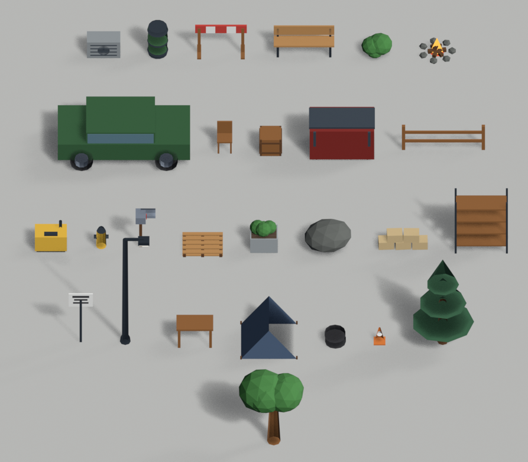

# propforge

**Low-poly game props, generated in one command.**



```bash
python propforge.py --count 60 --seed 7 --out assets/props
```

No Blender, no pip install, no textures, no licence roulette. One file, 27 prop
families, game-ready `.glb` output that a pipeline can eat.

```
assets/props/
  barrel_01.glb   crate_01.glb   tree_pine_01.glb   car_01.glb   ...
  manifest.json
```

## Why

Every prototype needs a hundred barrels, crates and trees before it looks like a
game. Placeholder cubes look wrong, and asset packs are either expensive or all
stylistically identical. propforge gives you a coherent, deterministic prop set
in the art style most sandbox games already use: flat-shaded, material-only,
100-500 triangles per prop.

## Install

Nothing to install - it is one file with no dependencies:

```bash
git clone https://github.com/<you>/propforge && cd propforge
python propforge.py --count 60 --out props
```

Or as a tool:

```bash
pipx install git+https://github.com/<you>/propforge
uvx --from git+https://github.com/<you>/propforge propforge -n 60 -o props
```

Python 3.8+. That is the whole requirement list.

## Usage

```
python propforge.py [-h] [-o OUT] [-n COUNT] [-s SEED] [-f FAMILIES]
                    [-b BUDGET] [--list] [-q] [--version]
```

| flag | meaning |
|---|---|
| `-o, --out` | output directory (default `props`) |
| `-n, --count` | how many props to generate (default 24) |
| `-s, --seed` | random seed - same seed, same pack, forever |
| `-f, --families` | comma-separated subset, e.g. `barrel,tree_pine,car` |
| `-b, --budget` | triangle budget per prop for validation (default 800) |
| `--list` | print every family |

Examples:

```bash
python propforge.py --list                          # what can it make
python propforge.py -n 200 -s 42 -o pack            # a big varied pack
python propforge.py -f barrel,crate,pallet -n 12    # a warehouse corner
python propforge.py -n 60 -o props -q               # silent, for CI
```

Every run validates its own output: triangle budget, file size, exactly one mesh
per file, and the mesh must sit on the ground plane (`y-min == 0`). Failures are
printed and the exit code is non-zero, so CI catches regressions.

## Families

`ac_unit` `barrel` `bench` `bush` `campfire` `car` `chair` `crate` `dumpster`
`fence` `generator` `hydrant` `mailbox` `pallet` `planter` `rock` `sandbags`
`shelf_rack` `sign` `street_lamp` `table` `tent` `tire_stack` `traffic_cone`
`tree_pine` `tree_round` `barrier`

Each family randomises proportions, part counts and palette within a plausible
range, so `-n 60` gives you 60 different props, not 60 copies.

## Output format

Written straight into glTF 2.0 binary:

- **Y-up**, metres, origin at the bottom-centre of the footprint
- **flat shading** - a normal per triangle, not per vertex
- **materials only** - `baseColorFactor` + roughness/metallic, no UVs, no images
- **no indices**, no extras, no extensions - any importer reads it
- ~100-500 triangles per prop, ~1-30 KB per file

That means: drop the folder into Godot and it just works, feed it to Unity with
a glTF importer, or into Unreal via the glTF importer. No material setup needed.

`manifest.json` lists every prop with family, tri count, material count, byte
size and bounding-box dimensions - handy for spawn tables and build scripts.

## Adding a family

A family is a function that fills a `Mesh` and returns it:

```python
def barrel(rng):
    m = Mesh()
    body = m.mat(PALETTE["rust"], 0.75, 0.35)   # colour, roughness, metallic
    h = rng.uniform(0.88, 1.05)
    cyl(m, body, (0, 0, 0), 0.30, 0.28, h, 14)  # base, r_bottom, r_top, height
    return m
```

Register it in `FAMILIES` and it shows up in `--list`, the pack generator and
validation. Helpers: `box`, `cyl`, `blob` (icosphere), `quad`, `tri`; every
shape takes yaw/pitch/roll and a material key.

## Rendering the contact sheet

`tools/` has the build-time extras (they do need Blender + Pillow, unlike the
generator itself):

```bash
blender --background --factory-startup --python tools/render_hero.py -- \
    --props demo/props --out docs/hero.png --res 1600
python tools/frame.py docs/hero.png --margin 0.04
```

## License

MIT. The props you generate are yours - no attribution required.
